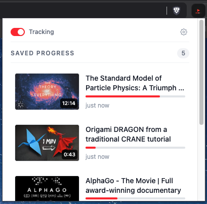

# YouTube Tracker



A Chrome and Firefox browser extension that automatically tracks your progress on YouTube videos and resumes playback from where you left off.

## Features

- **Automatic Progress Tracking**: Saves your position in videos as you watch
- **Smart Resume**: Automatically resumes videos a few seconds before your last watched position, with an in-player "Resumed at 12:34 · Start over" notice
- **Intelligent Save Intervals**:
  - Short videos (<15 min): Saves every 5 seconds
  - Long videos (≥15 min): Saves every 30 seconds
- **Cross-Session Persistence**: Your progress is saved even if you close the browser
- **Only What Matters**: Nothing is saved before 15 seconds, videos in their last 5% (up to 60s) count as finished and are removed, live streams, ads and YouTube Music are skipped, and links with an explicit `&t=` start time are respected
- **Don't Track**: Exclude individual videos from the popup or options page; re-enable them from the options page's "Not tracked" list
- **Undo**: Removing a video (or clearing all) can be undone for 5 seconds
- **YouTube SPA Support**: Works seamlessly with YouTube's navigation without page reloads
- **Keyboard Shortcuts**: `Alt+Shift+Y` pauses/resumes tracking, `Alt+Shift+L` reopens your most recent video where you left off — no need to open the popup
- **At-a-Glance Status**: The toolbar icon badge shows your tracked video count, or a paused indicator when tracking is off
- **Popup**: Your 10 most recent videos, with a link to the full list
- **Options Page**: Manage all tracked videos, export/import your data as JSON (import merges, keeping the newer progress per video), or clear everything
- **Dark Mode**: Popup and options pages follow your OS/browser theme automatically
- **Multi-Browser Support**: Available for both Chrome and Firefox

## Installation

### For End Users

Releases are published from `v*` tags. If none is listed yet, build from source (see [For Developers](#for-developers)) and load `.output/chrome-mv3/` or `.output/firefox-mv2/`.

**Chrome/Edge:**
1. Download the latest release from the [Releases](https://github.com/franverona/youtube-tracker/releases) page
2. Extract the ZIP file
3. Open Chrome and navigate to `chrome://extensions/`
4. Enable "Developer mode" in the top right
5. Click "Load unpacked" and select the extracted folder

**Firefox:**
1. Download the `-firefox.zip` from the [Releases](https://github.com/franverona/youtube-tracker/releases) page
2. Open Firefox and navigate to `about:debugging#/runtime/this-firefox`
3. Click "Load Temporary Add-on…" and select the downloaded ZIP file

The release ZIP isn't signed by Mozilla, so release Firefox only loads it temporarily (until restart).

### For Developers

#### Prerequisites

- Node.js ≥24.15.0 (use `.nvmrc`: `nvm use`)
- pnpm — `corepack enable` (bundled with Node 24) uses the version pinned in `package.json`'s `packageManager`; on Node 25+, which no longer bundles corepack, use `npm i -g pnpm`

#### Setup

```bash
# Clone the repository
git clone https://github.com/franverona/youtube-tracker.git
cd youtube-tracker

# Use the correct Node version
nvm use

# Install dependencies (also sets up git hooks via husky)
pnpm install

# Start development mode (Chrome)
pnpm run dev
```

The extension will be built to the `.output/chrome-mv3/` directory. Load the unpacked extension from there.

## Development

### Available Commands

```bash
# Development (with hot reload)
pnpm run dev              # Chrome
pnpm run dev:firefox      # Firefox

# Build for production
pnpm run build            # Chrome
pnpm run build:firefox    # Firefox

# Create distributable ZIP files
pnpm run zip              # Chrome
pnpm run zip:firefox      # Firefox

# Run tests
pnpm run test

# Type checking
pnpm run type-check

# Lint
pnpm run lint

# Format with Prettier / check formatting (CI runs the check)
pnpm run format
pnpm run format:check
```

### Project Structure

```
youtube-tracker/
├── src/
│   ├── entrypoints/
│   │   ├── background.ts       # Toolbar badge/title, storage writes, keyboard shortcuts
│   │   ├── content.ts          # Content script (YouTube tracking logic)
│   │   ├── content/
│   │   │   ├── videoUtils.ts        # Save/load progress helpers
│   │   │   ├── videoUtils.test.ts
│   │   │   ├── resumeNotice.ts      # "Resumed at … · Start over" notice
│   │   │   ├── resumeNotice.test.ts
│   │   │   ├── youtubeUtils.ts      # DOM helpers (video element, title, ID)
│   │   │   └── youtubeUtils.test.ts
│   │   ├── popup/
│   │   │   ├── index.html
│   │   │   ├── main.tsx
│   │   │   ├── App.tsx         # Popup UI: tracking toggle + 10 most recent videos
│   │   │   └── App.css
│   │   └── options/
│   │       ├── index.html
│   │       ├── main.tsx
│   │       ├── App.tsx         # Options page: full list, export/import, clear all, don't-track list
│   │       └── App.css
│   ├── hooks/
│   │   ├── index.ts
│   │   ├── useVideoStorage.ts  # Shared React hook for live storage updates
│   │   ├── useUndo.ts          # Undo for removals (popup + options)
│   │   ├── useUndo.test.tsx
│   │   └── useIgnoredVideos.ts # Live don't-track list (options page)
│   ├── storage/
│   │   ├── index.ts            # Barrel, imported as `@/storage`
│   │   ├── videoStorage.ts     # Storage abstraction (wxt/utils/storage)
│   │   └── videoStorage.test.ts
│   ├── utils.ts                # formatTime / timeAgo
│   ├── utils.test.ts
│   └── test/
│       ├── setup.ts            # Vitest global setup (suppress console.warn)
│       ├── content.test.ts     # Content script tests
│       └── background.test.ts  # Background script tests
├── public/
│   ├── icon.svg
│   ├── icon-16.png
│   ├── icon-48.png
│   └── icon-128.png
└── wxt.config.ts               # Manifest incl. keyboard commands
```

### Tech Stack

- **Framework**: [WXT](https://wxt.dev) + React 19
- **Language**: TypeScript 6
- **Styling**: Tailwind CSS 4
- **Build Tool**: Vite (via WXT)
- **Testing**: Vitest with jsdom environment
- **Linting**: ESLint 9 (`eslint.config.mjs`) with typescript-eslint, react, react-hooks, and eslint-config-prettier
- **Formatting**: Prettier (with the Tailwind CSS plugin)
- **Git Hooks**: Husky — lint-staged on pre-commit, commitlint on commit-msg

### How It Works

1. **Content Script Injection**: The extension injects a content script on YouTube pages (`https://*.youtube.com/*`, except `music.youtube.com`) and starts tracking on watch pages

2. **Video Detection**: The script monitors for video elements and extracts the video ID from the URL. It follows YouTube's in-page navigation, and YouTube replacing the player's `<video>` element

3. **Progress Monitoring**: Event listeners track video playback events:
   - `play`: Starts periodic progress saving
   - `pause`: Saves progress immediately
   - `ended`: Clears saved progress for that video

   Nothing is saved before 15 seconds of progress. In the last 5% of a video (capped at 60 seconds) a save removes the entry instead, so leaving on the credits or end screen counts as finished. Live streams aren't tracked, and nothing is saved or removed while an ad is playing (ads use the same `<video>`). Progress is also saved the moment you navigate away, including into the miniplayer (playback inside the miniplayer itself isn't tracked).

4. **Resume on Load**: When you revisit a video, the script:
   - Retrieves saved progress from the extension's local storage (`storage.local`)
   - Waits for video data to load, and for any pre-roll ad to finish
   - Seeks 3 seconds before the saved position and starts playback if the player was paused, unless the URL has an explicit `t=`/`start=` time, the save is within 5 seconds of the end, or the video is already playing past it
   - Shows a "Resumed at 12:34 · Start over" notice on the player for a few seconds; Start over rewinds to the beginning and forgets the saved position

5. **Storage**: Data lives in the extension's `storage.local` under two keys:
   ```typescript
   {
     'video-storage': {
       [videoId]: {
         id: string
         progress: number      // Time in seconds
         duration?: number     // Video length in seconds
         timestamp: number     // Last save time
         title: string
         url: string
       }
     },
     'tracking-enabled': boolean,  // default: true
     'ignored-videos': { [videoId]: string }  // don't-track list, id → title
   }
   ```
   All writes (from every tab, the popup and the options page) are sent to the background script, which validates them and applies them one at a time so concurrent saves can't overwrite each other.

   Importing a backup merges it into what you have: for each video the entry with the newer save time wins, and nothing is deleted.

6. **Pause/Resume**: A separate `tracking-enabled` flag (default: on) gates loading and saving. Toggle it from the popup switch or the `Alt+Shift+Y` shortcut — the content script checks it before touching video progress, and the toolbar badge reflects the current state.

## Browser Support

- ✅ Chrome 110+
- ✅ Firefox 109+
- ✅ Edge (Chromium-based)

## Contributing

Contributions are welcome! Please feel free to submit a Pull Request.

### Development Workflow

1. Fork the repository
2. Create a feature branch (`git checkout -b feature/amazing-feature`)
3. Make your changes
4. Run the same checks as CI: `pnpm run test && pnpm run type-check && pnpm run lint && pnpm run format:check && pnpm run zip && pnpm run zip:firefox`
5. Commit using [Conventional Commits](https://www.conventionalcommits.org/) format (enforced automatically): `git commit -m 'feat: add amazing feature'`. The PR title must follow it too, since it becomes the squashed commit
6. Push to the branch (`git push origin feature/amazing-feature`)
7. Open a Pull Request

## License

MIT © [Francisco Verona](https://github.com/franverona)

## Support

If you encounter any issues or have questions, please [open an issue](https://github.com/franverona/youtube-tracker/issues) on GitHub.
